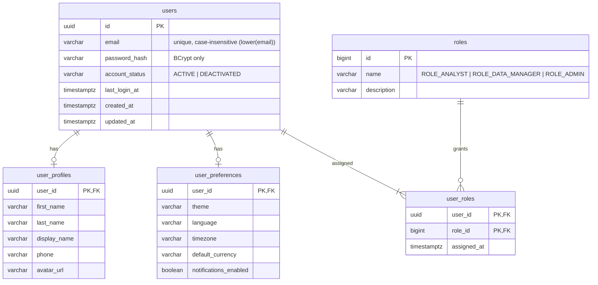

# Identity schema ER diagram (M5-02)

## Designed now, created in Sprint 2

Not created by V1 to V3. All reference `users.id` (UUID).

| Table | Columns (planned) |
|---|---|
| `api_keys` | id UUID PK, user_id UUID FK, name, key_hash (hash only, never the raw key), status (ACTIVE / REVOKED), permissions, expires_at, created_at, last_used_at |
| `api_usage_records` | id UUID PK, api_key_id FK, user_id FK, endpoint, status_code, success boolean, requested_at |
| `audit_logs` | id UUID PK, user_id UUID FK (nullable for failed logins), action, resource, metadata JSONB, created_at |
| `system_settings` | key PK, value, updated_by UUID FK, updated_at |

## For M2 / M3 / M4

Reference `users(id)` (UUID) as the FK target, e.g. `user_id UUID NOT NULL REFERENCES users(id)`.
Migration V1 is the contract; don't alter it without telling M5.

`users` is created by the auth service's Flyway migrations, which run **after** `init-db.sql`.
So don't put `REFERENCES users(id)` inside `init-db.sql`: add the foreign key afterwards
(for example `ALTER TABLE ... ADD CONSTRAINT ...` in a later migration, as V3 does).
Existing tables `portfolios` and `watchlists` get their FK to `users(id)` from migration V3.
